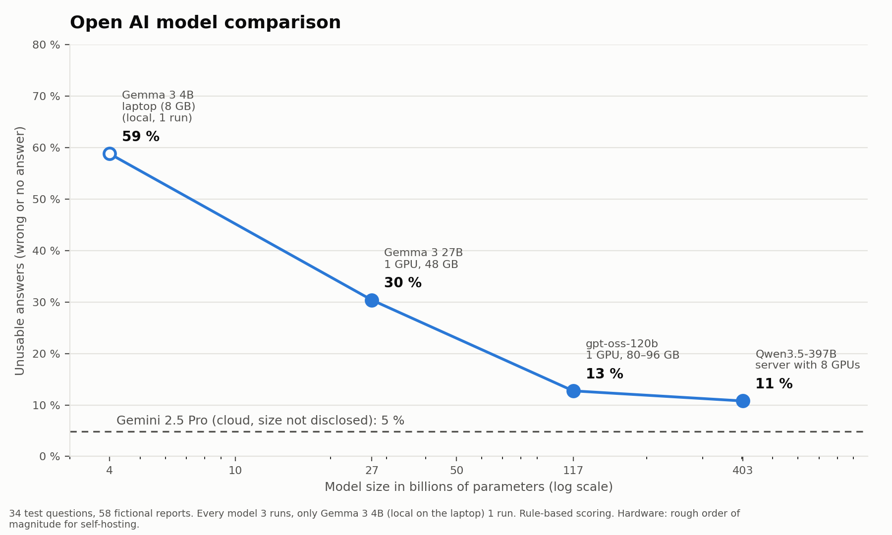

# AI Database for After-Action Reports (proof of concept)

A local assistant that answers plain-language questions across a collection of after-action reports (AARs). It cites the exact report behind every statement, gives the most recent rule priority over older ones, keeps to the context that was asked, and says openly when the reports contain nothing. New reports placed in a folder are picked up automatically.

**All reports in this repository are fictional and unclassified**, written only for testing. Nothing here is real doctrine or a validated recommendation.

- **Full documentation:** [`notes/technischer_bericht_de.md`](notes/technischer_bericht_de.md) (technical report, German; English version to follow) – goal, architecture, all experiments (v1–v21), results, limits, hardware forecast.
- **For AI agents continuing the work:** [`AGENTS.md`](AGENTS.md) – current state, architecture, rules, commands, open next steps.
- **Status:** November 2026, proof of concept complete; next step would be a pilot with real, unclassified reports on own hardware.

## How it works

1. **Folder → automatic sync.** Before every question the app checks which report files are new, changed or removed (file fingerprints) and processes only those.
2. **Reports → statement database.** A language model breaks each new report once into short statements (topic, type, context, verbatim quote); title and date are read by the program. Stored locally in SQLite.
3. **Question → selection.** A small local embedding model finds the 40 best-matching statements; their reports go to the language model in full.
4. **Answer with checks.** The model answers under fixed rules; every sentence carries a verbatim quote. The program verifies each quote, adds title and date as footnotes, and warns if a newer statement on the same topic and context exists.

## Key results (58 fictional reports, 34 test questions, 3 runs each)

| Answer model | Unusable answers (wrong or none) | Hardware for self-hosting (rough) |
|---|---|---|
| Gemma 3 4B, local on a laptop, offline | 59 % (1 run) | laptop, 8 GB |
| Gemma 3 27B | 30 % | 1 GPU, 48 GB |
| gpt-oss-120b | 13 % | 1 GPU, 80–96 GB |
| Qwen3.5-397B-A17B | 11 % | server with 8 GPUs |
| Gemini 2.5 Pro (cloud, reference) | 5 % | cloud only |

Offline operation was verified with the network disconnected (zero outside connections). Cost with the cloud model: about 3 US cents and 20 seconds per question, independent of collection size; ingesting a report costs 2–9 cents once.



## Quick start

Requires Python 3.9+. Run everything from the repository root.

```bash
python3 -m venv .venv && .venv/bin/pip install -r app/requirements.txt
.venv/bin/streamlit run app/app.py
```

The browser opens at http://localhost:8501. The default is a **free dummy mode** (no model, no key) to try the interface. The first start downloads the embedding model (~470 MB).

**Real answers (paid):** put an OpenRouter key into `.env` in the repository root (`OPENROUTER_API_KEY=...`; never commit it) and switch the app to Gemini 2.5 Pro. About 3 cents per question; ingesting the 58 test reports costs about 2 USD once.

**Offline with a local model:** install [Ollama](https://ollama.com), pull a model (e.g. `gemma3:4b`), then `bash scripts/offline_lauf.sh gemma3:4b <version>` runs the test questions locally and logs network connections. Small models on a laptop give poor answers (see results).

## Repository map

| Path | Content |
|---|---|
| `app/` | Streamlit app and core logic (`aidb.py`, `aussagen.py`, `suche.py`), prompts |
| `scripts/` | sync, test runs, rule-based scoring, chart, offline run, import test |
| `data/synthetic_reports/` | 58 fictional test reports, test questions with criteria, catalogue of built-in traps |
| `results/` | raw answers and evaluations of every experiment (version suffix `_v1` … `_v21`, `_s1` … `_s5`) |
| `notes/` | technical report, policy brief working files, figures |
| `verlauf/` | early project material (history, not the current state) |

Dataset versions are tagged `dataset-v1` … `dataset-v4` (v4 = current, 58 reports).

## Limits

Fictional, self-written test data; AI-assisted grading against fixed criteria; open models measured through a provider, not on own hardware; multi-user operation and access rights not tested. Details in the technical report.

## Licence

No licence has been chosen yet (to be decided after consultation). Until then, please ask before reusing the code.

*Drafted by Claude (Anthropic), based on the direction of Julien.*
