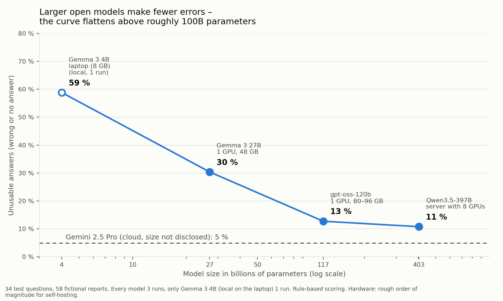

# Making Our After-Action Reports Usable: An AI Assistant on Our Own Network

*First draft written from `policy_brief_stichpunkte.md` (15 Nov 2026) as a starting point for the author's own text. Not for submission as is.*

---

## Summary

After-action reports hold our unit's experience, yet the newest and most relevant lessons are hard to find when they are needed. Over the past six weeks I built and tested a working prototype of an AI assistant that answers plain-language questions across a whole collection of reports. It cites the exact report behind every statement and gives the most recent rule priority over older ones. The approach keeps working as the collection grows, and it runs without any internet connection – provided the AI model is large enough, which requires a dedicated server. In our tests, a model that fits on a single large graphics card came close to a leading commercial cloud service. I ask you to endorse the idea of an AI-supported report database on our own hardware inside our closed network, and to support a pilot with real, unclassified reports.

## Context

**Lessons get lost.** We write after-action reports so that the next unit does not repeat our mistakes. In practice, nobody has time to read every report. Experience from another company, another exercise or last year stays in the archive and goes unused.

**Rules change, and the newest version is easy to miss.** Procedures are adjusted over time, often in a short paragraph of a report about something else. A soldier who finds the older report acts on an outdated procedure. At best this costs time; at worst it creates a safety risk.

**Answers must be trustworthy.** Nobody should act on a summary they cannot check. Any tool that answers questions about our reports has to show exactly where each statement comes from.

**Our collections keep growing.** A useful solution must cope with hundreds or thousands of reports and new ones every week, without creating extra work for the people who write them.

**Our reports cannot leave our network.** Commercial AI services run in the cloud. That rules them out for sensitive material. A solution has to run on our own hardware, inside our own network.

## Approach

I built a simple browser-based chat that answers questions about a folder of reports, and improved it over about twenty test rounds in October and November 2026. To avoid any security concern, I tested it only with 58 fictional, unclassified reports written for this purpose. Ten of them are long reports from a fictional training and exercise environment – vehicle service, rations, a winter bivouac, a visitors' day and range safety.

The reports contained deliberate traps: rules that change without saying so, a new rule mentioned only in passing on page three, similar wording in unrelated situations, conflicting experiences, and questions the reports simply cannot answer. Thirty-four test questions were asked three times each and graded against criteria set in advance. I compared a leading commercial cloud model with freely available models of different sizes, including a fully offline run on a laptop.

## Findings

**Every answer is traceable.** Each statement comes with a word-for-word quote and a footnote naming the report's title and date. The program checks every quote against the original report. After one safeguard was added, no invented sources occurred.

**The newest rule wins – most of the time.** With the leading cloud model, 95 percent of answers were free of critical errors. In about five percent, an older rule still appeared as valid. For these cases the program adds a warning – "possibly outdated, newer report dated …" – which catches part of them.

**The approach scales.** New reports placed in the folder are picked up automatically and broken down once into short "index cards", at a cost of two to nine US cents per report. After that, a question costs about three cents and takes about twenty seconds, no matter how large the collection is. In a test, ten reports added later were used immediately, including rule changes buried deep inside long reports.

**Running offline works.** A complete test run with the network disconnected showed zero connections to the outside. However, a small model running on a standard laptop gave unusable answers 59 percent of the time.

**Model size decides quality – but the benefit levels off.** The share of unusable answers fell from 30 percent with a mid-sized model to 13 percent with a model that fits on one large graphics card, and only to 11 percent with a model that needs a server with eight such cards. The leading cloud model stood at five percent (see figure).

**Answers stay on the question.** The assistant answers for the situation that was asked – garrison or exercise, seminar or bivouac – keeps answers short, and says openly when the reports contain nothing on a question.

**This evidence has limits.** The reports were written for the test and are shorter and tidier than real ones. Grading was done by AI against fixed criteria, with spot checks by me. The freely available models were tested through an external provider, not on our own server. Several users at once and access rights were not tested. Hardware prices are rough ranges only. Because the assistant's instructions were refined on the cloud model, the gap between it and the freely available models is probably smaller than measured.

## Implications

**This is feasible today.** The core functions work and can be measured; this is not a technology of the future.

**The hardware is a manageable investment.** A model in the class that performed well runs on one graphics card with 80 to 96 gigabytes of memory, roughly 15,000 to 25,000 US dollars for the card, plus server, operation and approval. Moving to a far larger model on an eight-card server – roughly 285,000 to 530,000 dollars – adds little in quality.

**We must expect a residual error rate.** With such a model, roughly one answer in ten may contain an error, most often an outdated rule. Footnotes and warnings let users check every statement. The assistant points users to the right reports; it does not replace reading them.

**How we file reports matters.** A fixed header with title and date makes the timeline reliable. Scanned documents need extra effort.

**Key questions lie outside the unit.** Security approval, access rights within the network and model licences have to be settled by the responsible offices.

## Recommendations

1. **Endorse the idea** of an AI-supported database for our after-action reports, running on our own hardware inside our closed network, and support it at the next level.
2. **Approve a pilot** with real, unclassified reports from one area, using a freely available model of the class tested here on a single server. The pilot should measure the same points as this study.
3. **Introduce a uniform filing format** for new reports: a fixed header with title and date, the author at the end, and the context (unit, situation, type of training). Avoid scanned PDFs.
4. **Make sources and warnings mandatory** in any system we adopt, and brief users to follow the footnotes.
5. **Ask the responsible offices to clarify** security approval for new hardware and software in the closed network, the computing capacity required, access rights (who may see which reports), and the licence terms of the chosen model.
6. **Plan the next steps with partners.** Multi-user operation with log-in and access rights is the next technical step. Universität der Bundeswehr München could contribute through computer-science theses or a hackathon.

*A detailed technical report, all test data and the program are available at https://github.com/Julien0049/AI-database.*
