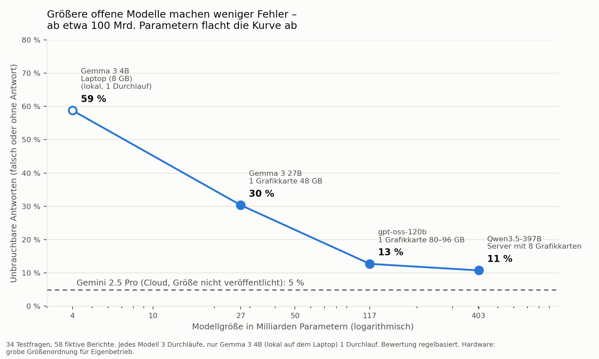

# KI-gestützte Datenbank für After-Action-Reports – Technischer Bericht zum Proof of Concept

*Langfassung zum Policy Brief. Stand: 15. November 2026. Für Leserinnen und Leser, die Aufbau, Versuche und Grenzen im Detail nachvollziehen oder die Arbeit fortsetzen wollen. Alle Zahlen sind gemessen, sofern nicht als Schätzung oder Vorschlag gekennzeichnet. Rohdaten und Einzelbewertungen liegen im Projektordner unter `results/`.*

---

## 1. Zusammenfassung

Erfahrungsberichte (After-Action-Reports, AARs) sollen Erfahrungen weitergeben. In der Praxis sind sie schwer zu erschließen: Niemand liest alle Berichte, Regeln ändern sich unbemerkt, abweichende Erfahrungen gehen unter. Dieser Proof of Concept (PoC) prüft, ob ein KI-Assistent Fragen zu einer Berichtssammlung zuverlässig beantworten kann: mit Quellen, mit dem jeweils neuesten Stand, ehrlich bei Lücken – und so, dass das Verfahren auch bei großen Sammlungen und ohne Internetverbindung funktioniert.

Gebaut wurde ein lokaler Browser-Chat, der über einen Ordner mit Berichten antwortet. In rund zwanzig Versuchsrunden wurde er mit 58 fiktiven, offenen Testberichten (darunter zehn lange Berichte aus einem fiktiven Lehrgangs- und Übungsbetrieb) und 34 Testfragen mit eingebauten Fallen geprüft.

Wichtigste Ergebnisse:

- **Belege sind überprüfbar.** Jede Aussage wird mit einem wörtlichen Zitat belegt; das Programm prüft jedes Zitat gegen den Bericht und setzt Titel und Datum als Fußnote. Erfundene Belege traten nur in einem Fall ohne Berichte auf; dieser Fall ist seither gesperrt.
- **Der neueste Stand gewinnt meistens.** Mit einem Spitzenmodell aus der Cloud (Gemini 2.5 Pro) waren 95 % der Antworten frei von kritischen Fehlern; in etwa 5 % erschien ein älterer Stand als gültig. Eine Programmprüfung warnt zusätzlich bei möglicherweise überholten Aussagen.
- **Das Verfahren skaliert.** Jeder Bericht wird beim Eingang einmal in kurze Einzelaussagen („Karteikarten“) zerlegt (2–9 Cent je Bericht). Danach kostet eine Frage etwa 3 Cent und 20 Sekunden, unabhängig von der Größe der Sammlung. Neue Berichte werden automatisch erfasst.
- **Offline ist technisch nachgewiesen** – ein vollständiger Testlauf ohne Internet, ohne jede Verbindung nach außen. Ein kleines Modell auf einem Laptop lieferte aber 59 % unbrauchbare Antworten.
- **Die Modellgröße entscheidet, die Kurve flacht ab.** Offene Modelle, die man selbst betreiben könnte: 30 % unbrauchbare Antworten bei 27 Mrd. Parametern, 13 % bei rund 120 Mrd. (eine große Grafikkarte), 11 % bei rund 400 Mrd. (Server mit acht Karten).

Empfehlung: einen Pilotbetrieb mit echten, offenen AARs auf eigener Hardware im geschlossenen Netz vorbereiten, mit einem offenen Modell der 120-Mrd.-Klasse, einheitlichem Ablageformat und verpflichtenden Quellen und Warnungen.

---

## 2. Ausgangslage und Ziel

### 2.1 Problem

AARs halten fest, was gut lief und was nicht. Ihr Nutzen hängt daran, dass spätere Leser die passenden Erfahrungen finden. Drei Hindernisse stehen dem entgegen:

1. **Menge:** Die Zahl der Berichte wächst schneller, als jemand sie lesen kann.
2. **Zeitliche Änderung:** Regeln und Verfahren ändern sich, oft nur nebenbei in einem Bericht zu einem anderen Thema. Wer den älteren Bericht findet, handelt nach einem überholten Stand.
3. **Kontext:** Gleiche Begriffe bedeuten in verschiedenen Lagen Verschiedenes (Fahrzeugrückgabe am Standort oder auf dem Truppenübungsplatz).

### 2.2 Anforderungen

Die Anforderungen wurden zu Beginn in einem Interview mit dem Auftraggeber erhoben und im Projektverlauf präzisiert (bestätigte Fassung in `AGENTS.md`):

- Die Berichtssammlung ist die **einzige Wissensquelle**; kein Ergänzen aus Modellwissen oder Internet.
- Bei **Regeln und Verfahren** bestimmt der jüngste vergleichbare Stand die Antwort; ältere Stände erscheinen nur, wenn ausdrücklich nach Änderungen gefragt wird.
- Bei **Erfahrungen** werden abweichende Sichtweisen nebeneinander genannt; das Datum allein begründet dort keinen Vorrang.
- Aussagen aus einem **anderen Kontext** als dem gefragten nur mit ausdrücklicher Kennzeichnung.
- **Fehlende Evidenz** wird offen benannt, Lücken werden nicht aufgefüllt.
- **Quellen** mit Titel und Datum als Fußnoten; Antworten exakt und knapp.
- **Neue Berichte** werden automatisch erfasst, ohne manuellen Import.

### 2.3 Rahmen

- Ausschließlich fiktive, offene Testdaten. Der PoC sendet Berichtstext für die meisten Versuche an ein Cloud-Modell; eingestufte Inhalte sind daher ausgeschlossen.
- Hardware: ein handelsüblicher Laptop (Apple M2, 8 GB Arbeitsspeicher).
- Antwortmodell für die Entwicklung: Gemini 2.5 Pro über den Vermittlungsdienst OpenRouter.
- Ziel für einen späteren Einsatz: Betrieb auf eigener Hardware im geschlossenen Netz, ohne Internet.

---

## 3. Begriffe in Kürze

| Begriff | Bedeutung im Bericht |
|---|---|
| **Sprachmodell** | Programm, das Text liest und Text erzeugt. Es wurde mit großen Textmengen trainiert und rechnet die wahrscheinlichste Fortsetzung aus. |
| **Parameter / Gewichte** | Die festen Zahlen, aus denen ein Modell besteht. Beim Training eingestellt, danach unverändert. Ihre Anzahl ist die „Größe“ (z. B. 120 Mrd.). |
| **Layer (Schicht)** | Ein Modell besteht aus vielen gleich gebauten Schichten hintereinander; jede verrechnet den Text mit großen Zahlentabellen – den Gewichten. |
| **Experten-Modell** | Modell aus vielen Teilmodellen, von denen je Wort nur wenige rechnen. Name z. B. „397B-A17B“: 397 Mrd. Parameter gesamt, 17 Mrd. aktiv. Speicher braucht es für alle, Rechenzeit vor allem für die aktiven. |
| **Kompression (Bit)** | Wie genau jede Zahl gespeichert wird. 16 Bit = 2 Byte je Parameter, 8 Bit = 1 Byte, 4 Bit = 0,5 Byte. Weniger Bit sparen Speicher, kosten etwas Qualität. |
| **Token** | Text-Baustein, mit dem Modelle rechnen (etwa ein Wortteil). Eine Anfrage in diesem PoC umfasst im Mittel rund 6.000 Token. |
| **Prompt** | Die Anweisungen und Texte, die das Modell zu jeder Frage erhält. Hier: Antwortregeln plus die ausgewählten Berichte. |
| **Suche nach Bedeutung** | Texte und Frage werden von einem kleinen Zusatzmodell in Zahlenreihen übersetzt; ähnliche Bedeutung ergibt ähnliche Zahlen. So werden passende Stellen auch ohne gleiche Wörter gefunden. |
| **Grafikspeicher** | Damit ein Modell schnell antwortet, müssen alle Gewichte im Speicher der Grafikkarte liegen. Daher entscheidet der Grafikspeicher, welches Modell eine Hardware tragen kann. |

---

## 4. Systemaufbau

### 4.1 Datenfluss

1. **Ablageordner:** Berichte liegen als Markdown, Text, Word oder PDF in einem festgelegten Ordner.
2. **Automatischer Abgleich:** Vor jeder Frage prüft das Programm über einen Fingerabdruck jeder Datei, was neu, geändert oder entfernt ist. Nur Neues wird verarbeitet.
3. **Zerlegung in Aussagen:** Das Modell zerlegt jeden neuen Bericht einmal in Einzelaussagen mit Thema, Art (Regel, Erfahrung, unklar, sonstiges), Kontext und wörtlichem Zitat. Titel und Datum liest das Programm selbst aus dem Bericht. Ergebnis ist eine dauerhafte Datenbank.
4. **Auswahl:** Zu einer Frage sucht das Programm die 40 inhaltlich passendsten Aussagen (Suche nach Bedeutung, lokal). Die Berichte, aus denen sie stammen, gehen vollständig an das Modell (im Mittel rund 18 bis 20 Berichte).
5. **Antwort:** Das Modell antwortet nach festen Regeln und belegt jeden Satz mit Berichtskennung und wörtlichem Zitat.
6. **Prüfungen im Programm:** Jedes Zitat wird gegen den Bericht geprüft; Titel und Datum werden als Fußnoten gesetzt. Zusätzlich prüft das Programm, ob es zum selben Thema im selben Kontext einen neueren Stand gibt, und warnt gegebenenfalls.
7. **Oberfläche:** Browser-Chat mit Fußnoten, Warnhinweisen und Protokoll aller Fragen.

### 4.2 Komponenten

| Datei | Aufgabe |
|---|---|
| `app/app.py` | Oberfläche (Streamlit), automatischer Abgleich vor jeder Frage |
| `app/aidb.py` | Berichte lesen (Markdown, Text, Word, PDF), Titel und Datum erkennen, Antwort anfordern, Zitate prüfen, Fußnoten setzen |
| `app/aussagen.py` | Aussagen-Datenbank (SQLite), Abgleich über Fingerabdrücke, Zerlegung durch das Modell |
| `app/suche.py` | Auswahl der Berichte, Prüfung auf möglicherweise überholte Aussagen |
| `app/prompt_antwort.txt`, `prompt_aussagen.txt` | Antwortregeln (8 Regeln) und Anweisung zur Zerlegung |

### 4.3 Harte Programmregeln statt Vertrauen ins Modell

Ein Grundsatz hat sich im Verlauf herausgebildet: **Was sich nachprüfen lässt, gehört ins Programm, nicht in die Anweisungen an das Modell.** Umgesetzt sind:

- Titel und Datum liest das Programm, nicht das Modell.
- Jedes Zitat wird auf wörtliches Vorkommen geprüft.
- Ohne passende Berichte wird das Modell gar nicht gefragt (sonst erfand es in einem Versuch eine Regel samt Zitat).
- Neue Dateien werden über Fingerabdrücke erkannt.
- Möglicherweise überholte Aussagen werden über Datum, Thema und Kontext der Datenbank erkannt und gemeldet.

Sprachverständnis – Bedeutung, Kontext, Zusammenfassung – bleibt beim Modell.

---

## 5. Testdaten und Bewertung

### 5.1 Testberichte

Die Testdaten wurden schrittweise erweitert und jeweils eingefroren:

| Stand | Berichte | Inhalt |
|---|---|---|
| dataset-v1 | 5 | Materialrückgabe |
| dataset-v2 | 13 | dazu Fahrzeugausleihe, Erfahrungen zur Winterkleidung |
| dataset-v3 | 48 | dazu Störberichte (ähnliche Wörter, fremde Themen), mehrere Stände zu einem Thema, längere Seminarberichte, Formatvarianten |
| dataset-v4 | 58 | dazu zehn lange Berichte (241–1.125 Wörter) aus einem fiktiven Lehrgangs- und Übungsbetrieb: Kfz-Dienst, Truppenverpflegung, Winterbiwak, Besuchertag, sanitätsdienstliche Absicherung einer Schießausbildung, Funkgeräte, Stubenabnahme, externe Ausbilder, Lehrsaaltechnik |

Eingebaute Fallen (Katalog in `data/synthetic_reports/README.md`):

- Regeln, die sich ändern, teils ohne sprachlichen Hinweis; der neuere Bericht steht in der Sammlung vor dem älteren.
- Eine neue Regel nur nebenbei, etwa in Abschnitt 4.3 eines langen Berichts.
- „Früher …“-Formulierungen und Sätze, die nur mit dem vorigen Absatz verständlich sind.
- Einschränkungen, die weit von der Regel entfernt stehen („gilt nur für den Übungsbetrieb“).
- Ähnliche Wörter in anderem Kontext (Raumschlüssel nach Abendseminaren vs. Stubenschlüssel).
- Abweichende Erfahrungen (Daunenjacke vs. Schichtenprinzip).
- Fehlende Daten, Daten nur in der Unterschrift, Bezugszeilen mit älterem Datum.
- Fragen, die die Berichte nicht beantworten.

Alle Berichte sind ausdrücklich fiktiv. Waffen und Taktik kommen nur auf allgemeiner, offen bekannter Ebene vor.

### 5.2 Testfragen

34 Testfragen (`data/synthetic_reports/test_questions.md`), jeweils mit erwarteten Belegen, Antwortentwurf und Kriterien: gezielte Fragen, Zusammenfassungen, Fragen nach Änderungen, Fragen ohne Antwort in den Berichten. Für den Nachtragstest gelten bei drei Fragen ab dataset-v4 angepasste Erwartungen, weil neue Berichte den Stand ändern.

### 5.3 Bewertung

- **Handbewertung (v1–v20):** jede Antwort als erfüllt, teilweise oder nicht erfüllt. „Nicht erfüllt“ bedeutet einen kritischen Fehler: überholter Stand als gültig, erfundene Regel oder keine verwertbare Antwort. Ab v11 zählen auch Störinhalte (verwandte, aber nicht gefragte Inhalte) als „teilweise“.
- **Regelbasierte Bewertung (v21):** je Frage Pflichtinhalte und verbotene Inhalte (`scripts/regelbewertung.py`). Bei „nicht erfüllt“ stimmt sie mit der Handbewertung genau überein (geprüft an zwei Läufen); bei „erfüllt“ ist sie großzügiger, weil sie Störinhalte nicht erkennt. Harte Kennzahl im Modellvergleich ist daher der Anteil unbrauchbarer Antworten.
- Jede Version lief in der Regel dreimal, um Schwankungen sichtbar zu machen.
- Die Bewertung stammt von einem KI-Agenten (Claude) nach festen Kriterien; der Auftraggeber prüft stichprobenartig.

---

## 6. Versuchsreihe

### Phase A – Antwortregeln und Belege (v1–v10, 5 bis 13 Berichte)

*Frage:* Hält sich ein Modell an Regeln für Aktualität, Kontext und Lücken, wenn es alle Berichte sieht?

- Die Grundfunktion trug von Beginn an: 5 von 6 (v1) bis 11 von 13 (v4) Fragen erfüllt.
- Eine Regel zur Unterscheidung von Regeln und Erfahrungen wirkte (v5): Sichtweisen wurden nebeneinander gestellt.
- **Belege je Satz mit wörtlichem Zitat (v7):** 213 von 213 Zitaten waren echt. Titel und Datum setzt seitdem das Programm.
- Kürzere Antworten durch eine Regel „exakt und knapp“ (v8: 11 % kürzer).
- Abweichende Formate (Datum in der Unterschrift, fehlende Überschrift) las das Programm korrekt (v9).
- **Datumstest (v10):** Zwei Berichte widersprechen sich ohne sprachlichen Hinweis; der neuere steht vorne und hat die kleinere Kennung. Das Modell wählte in 6 von 6 Fällen den neueren Stand.

*Folgerung:* Mit allen Berichten im Blick arbeitet ein Spitzenmodell regelkonform. Offen blieb, was bei großen Sammlungen geschieht.

### Phase B – Suche bei mehr Berichten (s1–s5, v11–v13, 48 Berichte)

*Frage:* Große Sammlungen passen nicht in eine Anfrage. Findet eine vorgeschaltete Suche die nötigen Berichte?

- **Suchtests ohne Modell (s1–s5):** Die Suche nach Bedeutung fand bei 79 % der Fragen alle nötigen Berichte unter den ersten fünf, Stichwortsuche nur 50 %. Kleinere Sucheinheiten, Themenerweiterung und ein größeres Suchmodell brachten keinen Gewinn. Ausfälle betrafen stets Zusammenfassungen und nur nebenbei erwähnte neue Stände.
- **Antwortläufe:** alle 48 Berichte im Prompt 64 von 75 erfüllt (v11); nur die fünf besten Treffer 51 von 75, davon dreimal ein überholter Stand als gültig (v12). Eine Sichtung aller Berichte durch das Modell in Paketen fand 129 von 132 nötigen Berichten, kostete aber 10 Cent und 35 Sekunden je Frage und brachte großzügig Störinhalte ein (v13: 57 von 75).

*Folgerung:* Unvollständige Auswahl ist das kritische Risiko: Fehlt der neuere Bericht, gibt das Modell überzeugend den älteren Stand wieder – mit gültiger Fußnote. Eine reine Suche über ganze Berichte reicht nicht; eine vollständige Sichtung skaliert nicht.

### Phase C – Aussagen-Datenbank (v14–v16)

*Frage:* Lässt sich die Arbeit vom Fragezeitpunkt auf den Eingang verlagern?

- **Zerlegung beim Eingang (v14):** 48 Berichte ergaben 160 Aussagen mit Thema, Art, Kontext und Zitat (1,01 USD einmalig). Nebenbei erwähnte Regeln wurden als eigene Regel erfasst; Unsicheres markierte das Modell als „unklar“.
- **Antworten nur aus Aussagen (v15):** günstig (rund 3 Cent je Frage), aber schwächer (50 von 75): Aus dem Zusammenhang gelöste Teilschritte alter Verfahren wurden beigemischt.
- **Aussagen zum Finden, Berichte zum Antworten (v16):** Die besten 40 Aussagen bestimmen die Berichte, das Modell bekommt diese vollständig. Ergebnis 58 von 75, kein überholter Stand als gültig, 2,4 Cent je Frage.

*Folgerung:* Der Aufbau aus v16 verbindet die Treffsicherheit kurzer Aussagen mit dem Zusammenhang ganzer Berichte. Er ist seitdem Grundlage aller Versuche und der Oberfläche.

### Phase D – Lange militärische Berichte und Nachtragstest (dataset-v4, v17)

*Frage:* Trägt der Aufbau bei langen, realistischeren Berichten, und fließen neue Berichte ohne Neuaufbau ein?

- **Nachtragstest beim Einlesen:** Beim Abgleich wurden nur die zehn neuen Berichte verarbeitet, die 48 vorhandenen nicht erneut (0,82 USD). Alle vergrabenen Regeländerungen (Fahrzeuge nur noch über ein Portal mit drei Werktagen Vorlauf; digitale Mängelmeldung statt Formular; Beamer über IT-Ticket; neue Verpflegungsanmeldung) wurden als Regel mit passendem Kontext erfasst und von der Suche jeweils als bester Treffer gefunden.
- **Datumserkennung:** Bei 3 von 10 langen Berichten las das Programm zunächst das Datum einer Bezugszeile oder eines Übungstags statt des Berichtsdatums. Behoben (Vorrang für eine Zeile „Datum:“, dann für die Unterschrift). In der Praxis steht das Datum bei ordentlicher Stabsarbeit im Briefkopf; der Fall unterstreicht den Wert eines einheitlichen Ablageformats.
- **Antwortlauf (v17):** Neue Fragen zu den langen Berichten 26 von 27 erfüllt. Bei den älteren Fragen trat eine neue Fehlerart auf: **Kontextvermischung** – Biwak-Erfahrungen flossen ungekennzeichnet in Antworten zu Winterseminaren ein.

### Phase E – Kontext und Antwortlänge (v18–v19)

- **Regel 8 (v18):** Aussagen aus anderem Kontext nur mit ausdrücklicher Kennzeichnung. Die Vermischung verschwand weitgehend (83 von 102 erfüllt, 2 nicht erfüllt).
- **Messung der Länge:** Mit wachsender Sammlung wurden Antworten deutlich länger (Zusammenfassungen 109 Wörter bei 48 Berichten → 175 Wörter bei 58 Berichten), weil das Modell Verwandtes einbaut.
- **Regel 8 verschärft (v19):** Nur der gefragte Kontext; ein gekennzeichneter Satz nur, wenn die Frage den Kontext offenlässt oder zum gefragten Kontext nichts vorliegt. Zusammenfassungen wurden 23 % kürzer (135 Wörter). Aber: In 5 von 102 Antworten erschien ein überholter Stand als gültig, weil das Modell einen neuen Stand teils als „anderen Kontext“ abtat.

*Folgerung:* Kontext und Aktualität stehen in Spannung. Ob ein neuerer Bericht denselben Fall regelt, ist genau die Unterscheidung, bei der das Modell unsicher ist – ein Argument für eine zusätzliche Prüfung im Programm.

### Phase F – Programmprüfung auf überholte Aussagen

- Jeder Beleg wird der passenden Aussage der Datenbank zugeordnet. Gibt es zum selben Thema im selben Kontext eine neuere, inhaltlich andere Regel, wird gewarnt.
- An 288 vorhandenen Antworten (v17–v19): alle 10 bekannten Fehler erkannt, 7 % Fehlalarme (ohne Kontext- und Bestätigungsfilter: 46 %).
- An Antworten anderer Modelle (v21) erkannte die Prüfung nur 30–56 % der Fehler, weil ihre Schwellen an Gemini-Antworten abgestimmt wurden.
- In der Oberfläche getestet: Bei einer falschen Antwort erschien die Warnung mit Titel und Datum des neueren Berichts; bei einer richtigen Antwort keine Warnung.

*Folgerung:* Die Prüfung ist eine sinnvolle Absicherung, kein Ersatz für ein gutes Modell.

### Phase G – Offline-Betrieb und Modellgröße (v20–v21)

- **Offline-Lauf (v20):** Gemma 3 4B (Google, 3,4 GB, 4-Bit) über die Software Ollama auf dem Laptop. Der gesamte Lauf erfolgte bei getrenntem Internet; ein Protokoll prüfte alle zehn Sekunden Erreichbarkeit und Verbindungen: **0 Verbindungen nach außen**. Qualität: 59 % unbrauchbare Antworten (35 % inhaltlich falsch, 24 % ohne verwertbare Antwort), im Mittel 74 Sekunden je Frage.
- **Größenleiter (v21):** Offene Modelle, deren Gewichte frei verfügbar sind und die man im geschlossenen Netz selbst betreiben könnte, gemessen über OpenRouter (Qualität im Eigenbetrieb gleich, sofern gleich komprimiert).

| Modell | Parameter (gesamt / aktiv) | Lizenz | unbrauchbar | davon inhaltlich falsch | Kosten 102 Antworten |
|---|---|---|---|---|---|
| Gemma 3 4B (lokal, 1 Durchlauf) | 4 Mrd. | Gemma | 59 % | 35 % | 0 |
| Gemma 3 27B | 27 Mrd. | Gemma | 30 % | 29 % | 0,07 USD |
| gpt-oss-120b | 117 / 5 Mrd. | Apache 2.0 | 13 % | 11 % | 0,06 USD |
| Qwen3.5-397B-A17B | 403 / 17 Mrd. | Apache 2.0 | 11 % | 9 % | 1,56 USD |
| Gemini 2.5 Pro (v19) | nicht veröffentlicht | proprietär | 5 % | 5 % | 3,14 USD |

Häufigster Fehler aller Modelle: ein älterer Stand als gültig oder gleichrangig („zwei Werktage“, „Download oder USB-Stick“). Kleinere Modelle vermischten zusätzlich Regeln verschiedener Themen und übertrugen Zahlen aus fremdem Kontext.

---

## 7. Ergebnisse quer gelesen

| Anforderung | Ergebnis (Spitzenmodell, Aufbau v19) | Bemerkung |
|---|---|---|
| Einzige Wissensquelle, Belege | jede Aussage mit geprüftem Zitat und Fußnote | erfundene Belege nur ohne Berichte, seither gesperrt |
| Neuester Stand bei Regeln | 95 % ohne kritischen Fehler | Restrisiko ~5 %; Programmwarnung zusätzlich |
| Sichtweisen bei Erfahrungen | abweichende Erfahrungen nebeneinander | Daunenjacke vs. Schichten durchgehend richtig |
| Kontext | nach Regel 8 weitgehend getrennt | Spannung mit Aktualität (Phase E) |
| Lücken offen benennen | durchgehend | keine Übertragung von Fristen aus anderen Themen |
| Knappe Antworten | gezielte Fragen ~37 Wörter, Zusammenfassungen ~135 Wörter | ohne Kontextregel wachsen Antworten mit der Sammlung |
| Automatische Erfassung | nur neue/geänderte Berichte, einmalig 2–9 Cent je Bericht | Nachtragstest bestanden |
| Kosten und Dauer je Frage | ca. 3 Cent, ca. 20 Sekunden | unabhängig von der Sammlungsgröße |

Bekannte Schwächen über alle Läufe:

- Verantwortlichkeit wird meist nur indirekt verneint („aus dem Fehlen allein wird keine persönliche Verantwortung abgeleitet“) statt ausdrücklich als offen benannt.
- Themenübergreifende Sammelfragen („alles zu Gästen und Besuchern“) finden nicht alle Berichte, weil die Aussagen auf viele Themen verteilt sind.
- Inhaltlich verwandte Störberichte (Winterdienst in Winter-Zusammenfassungen) gelangen gelegentlich in Zusammenfassungen.

---

## 8. Prognose für den Eigenbetrieb

### 8.1 Qualität nach Modellgröße



Der größte Gewinn liegt zwischen 27 und rund 120 Mrd. Parametern; darüber flacht die Kurve ab. Ein Modell der 120-Mrd.-Klasse macht etwa doppelt so viele kritische Fehler wie das Spitzenmodell aus der Cloud, aber kaum mehr als ein dreimal so großes offenes Modell.

### 8.2 Speicherbedarf und Hardware (Schätzung)

Speicher für die Gewichte ≈ Parameter × Byte je Parameter, zuzüglich 20–50 % für den verarbeiteten Text und gleichzeitige Nutzer.

| Modellklasse | Speicher Gewichte | Hardware (grob) | Kosten Grafikkarten (grob) |
|---|---|---|---|
| ~27 Mrd. | ca. 28 GB (8 Bit) | 1 Karte mit 48 GB (z. B. L40S) | ca. 7.000–10.000 USD |
| ~120 Mrd., Experten-Modell | ca. 61–65 GB (4-Bit-Format des Herstellers) | 1 Karte mit 80–96 GB (z. B. H100, RTX PRO 6000) | ca. 15.000–25.000 USD je Karte |
| ~400 Mrd., Experten-Modell | ca. 400 GB (8 Bit) | 1 Server mit 8 Karten (H100/H200) | ca. 285.000–530.000 USD (ganzer Server) |

Die Preisangaben stammen aus Händler- und Fachquellen von 2026 und widersprechen sich teilweise stark. Nicht enthalten sind Server-Gehäuse, Betrieb, Personal, Zulassung und Wartung.

### 8.3 Lizenzen

- **gpt-oss-120b, Qwen3.5:** Apache 2.0 – frei nutzbar, auch kommerziell und im Eigenbetrieb.
- **Gemma, Llama:** eigene Lizenzbedingungen der Hersteller mit Nutzungsbeschränkungen – vor einem dienstlichen Einsatz rechtlich zu prüfen.

### 8.4 Was die Prognose nicht abdeckt

- Eigene Serverhardware wurde nicht gemessen; die offenen Modelle liefen bei Anbietern mit nicht überprüfbarer Rechengenauigkeit.
- Mehrere gleichzeitige Nutzer, Antwortzeiten unter Last und Zugriffsrechte wurden nicht getestet.
- Die Antwortregeln wurden über drei Wochen am Cloud-Modell geschärft; die offenen Modelle liefen ohne Anpassung. Der Abstand ist daher eher kleiner als gemessen. Eine Anpassung an die heutigen offenen Modelle wurde bewusst nicht vorgenommen, weil im späteren Betrieb ohnehin ein dann aktuelles Modell eingesetzt wird; die Abstimmung auf das Zielmodell gehört in den Pilot.

---

## 9. Grenzen

- **Daten:** 58 fiktive, vom Agenten verfasste Berichte; Fallen und Fragen stammen vom selben Agenten, der auch bewertet. Echte Berichte sind länger, uneinheitlicher und enthalten Fehler.
- **Bewertung:** KI-gestützt nach festen Kriterien, Stichproben durch den Auftraggeber; Unterschiede von ein bis drei Antworten liegen im Bereich der Schwankung zwischen Läufen.
- **Modelle:** ein Spitzenmodell, drei offene Modelle, eine Sprache (Deutsch); Ergebnisse gelten für die getestete Datensatzgröße.
- **Preise:** nur Größenordnungen.
- **Sicherheit:** Der Offline-Nachweis ist ein Test auf einem Laptop, keine Sicherheitszertifizierung. Im echten Betrieb sichert das geschlossene Netz die Trennung.

---

## 10. Empfehlungen und nächste Schritte

1. **Pilot vorbereiten:** echte, offene AARs eines Bereichs; offenes Modell der ~120-Mrd.-Klasse auf eigenem Server im geschlossenen Netz; gleiche Messgrößen wie hier (Genauigkeit, neuester Stand, Lücken, Belege), die Testfragen sind wiederverwendbar.
2. **Einheitliches Ablageformat:** Briefkopf mit Titel und Datum an fester Stelle, Verfasser am Ende, Kontext (Einheit, Lage, Art der Ausbildung); keine eingescannten PDFs.
3. **Quellenpflicht und Warnungen** als feste Bestandteile jedes Systems.
4. **Nutzer einweisen:** gezielte Fragen, Fußnoten prüfen; der Assistent führt zu den Berichten, ersetzt sie nicht.
5. **Klärung durch zuständige Stellen:** Zulassung neuer Hard- und Software im geschlossenen Netz, Rechenkapazität, Zugriffsrechte nach Einstufung und Personenkreis, Lizenzen.
6. **Mehrnutzerbetrieb** mit Anmeldung, Zugriffsrechten und gleichzeitigen Anfragen als eigener Schritt nach dem Pilot.
7. **Universität der Bundeswehr München einbinden:** Abschlussarbeiten (Informatik) zu Serverbetrieb und Lasttest, Zugriffsrechten, Pilot mit echten Daten und Nutzerstudie, Feinabstimmung eines offenen Modells oder eines kleinen Klassifikators; Hackathon für kurze Aufgaben (Texterkennung eingescannter Berichte, Anbindung an Ablagesysteme, gezielte Angriffs- und Fehlertests).

---

## 11. Anhang

### 11.1 Reproduktion

Im Projektordner:

```bash
python3 -m venv .venv && .venv/bin/pip install -r app/requirements.txt
.venv/bin/streamlit run app/app.py                      # Oberfläche (Standard: kostenlose Attrappe)
.venv/bin/python scripts/aussagen_einlesen.py --modell  # Ordner abgleichen (kostet Guthaben)
.venv/bin/python scripts/antwortlauf_aussagen.py --volltext --durchlaeufe 3   # Antwortlauf
.venv/bin/python scripts/regelbewertung.py results/ergebnisse_*_v21.json      # Bewertung
.venv/bin/python scripts/grafik_modellgroesse.py        # Abbildung
bash scripts/offline_lauf.sh gemma3:4b v20               # Offline-Lauf (Ollama erforderlich)
```

Für echte Antworten wird ein OpenRouter-Schlüssel in `.env` benötigt; Läufe mit Modell kosten Guthaben.

### 11.2 Kosten

| Posten | Kosten |
|---|---|
| Versuche v1–v12 (alter Schlüssel, 10 USD/Monat) | im Einzelnen nicht erfasst, Budget im November ausgeschöpft |
| Versuche ab v13 (neuer Schlüssel, 50 USD für 30 Tage) | rund 24 USD gemessen, zuzüglich höchstens ca. 3 USD für einen abgebrochenen Lauf |
| Einlesen von 58 Berichten in die Aussagen-Datenbank | 1,88 USD einmalig |
| Eine Frage im Endaufbau (Spitzenmodell) | ca. 3 Cent |
| Offline-Lauf auf dem Laptop | 0 USD |

### 11.3 Versuchsübersicht

Vollständige Tabelle aller Versionen mit Änderung und Ergebnis: `notes/policy_brief_notes.md`, Abschnitt „Versuchsübersicht“; Einzelbewertungen in `results/bewertung_*.md`.

### 11.4 Netzprotokoll des Offline-Laufs

`results/netzprotokoll_v20_2026-11-14.txt`: Lauf von 21:38 bis 22:30 Uhr bei getrennter Internetverbindung, Prüfung alle zehn Sekunden, 0 Verbindungen nach außen, 0 Mal Internet erreichbar.

---

*Drafted by Claude (Anthropic), based on the direction of Julien.*
